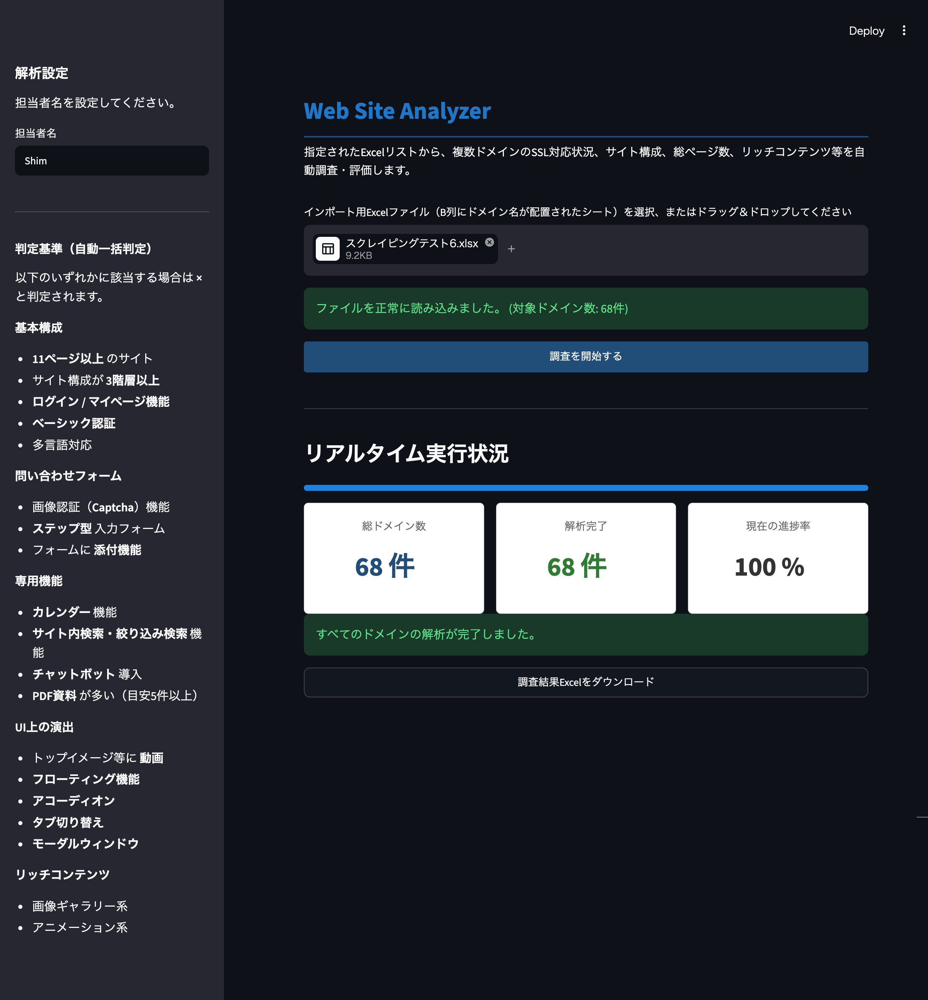

**English** | [日本語](README.md)

---

# Web Site Analyzer

A GUI-based multi-domain website analysis and evaluation system, built for learning Python and as a portfolio project.

It was developed to systematically learn practical backend architecture patterns used in real-world systems: concurrency (thread-safe state management in a multi-threaded `ThreadPoolExecutor` environment), crash-resilient state persistence with SQLite, defensive techniques for robust crawling, and state management built around the value-object design philosophy.

---

## Overview

Given an Excel list of domains (with domain names in column B), this web application automatically crawls each domain to check **SSL support (including whether HTTPS is enforced), site structure (multi-signature CMS detection), and total page count**, then assigns a business evaluation (**× or 要確認 / "needs review"**) based on a page-count threshold (10 pages by default), site depth, presence of a login/member area, file-attachment support in contact forms, Basic Authentication, multilingual support, CAPTCHA on contact forms, specialized features (calendars, on-site search, chatbots), design gimmicks (video, floating buttons, accordions, tabs, modals), and rich content (Lightbox galleries, scroll animations, etc.).

This is more than a simple scraper: it implements its own crawl-rate throttling to minimize load on target servers, spoofed headers to work around Cloudflare and similar bot-blocking (403/401 errors), detection and root-cause classification of block pages served by network security appliances such as Fortinet, detection of "site has moved" redirect pages (automatic redirects to a different domain), a two-tier SSL audit mechanism combining HTTP redirect tracking with a direct HTTPS check, and a safety mechanism that detects infinite link traps and aborts crawling.

Job state is persisted to SQLite, so job progress is automatically recovered on the next startup even if the app is force-terminated.

The frontend is built with Streamlit. By coordinating `st.rerun()` with a background thread (internally, a pool of parallel workers managed by `ThreadPoolExecutor`), the app delivers a real-time monitoring UI that renders progress smoothly without ever freezing.

---

## Key Features

* **Parallel crawling (thread-pool control via `ThreadPoolExecutor`)**
  * The entire job is delegated to a background thread via `threading`, and within that job, individual domains are processed concurrently by a `ThreadPoolExecutor` (5 workers by default). The worker count is tuned to balance throughput against memory pressure, even for heavier operations that involve JS rendering (Playwright).
  * If an exception occurs while processing one domain, only that domain's result is recorded as "needs review" — processing of other domains, and completion of the job as a whole, continues uninterrupted.
  * Mutual exclusion (`threading.Lock`) ensures that result writes from multiple worker threads are applied atomically, completely eliminating data races and display inconsistencies with the thread reading progress on Streamlit's side.
  * The Streamlit rendering main thread is kept 100% free even during heavy network I/O, eliminating UI freezes.

* **Crash-resilient state persistence with SQLite**
  * Jobs and assessment results are synced not only to an in-memory cache but also to SQLite running in WAL mode. Each domain's result is written to the DB the moment it completes, so no completed work is lost even if the process dies mid-run.
  * On startup, a consistency check (`reconcile_interrupted_jobs`) automatically detects any job still left in a `processing` state from an abnormal termination and marks it `interrupted`, preventing the UI from appearing to hang forever in a "processing" state.
  * `st.cache_resource` shares a single instance of the service layer across the whole process, so job progress survives browser reloads and session disconnects.

* **Intelligent crawler-defense evasion and SSL auditing**
  * **Smart SSL & redirect verification**: The initial request is made over `http://`, tracking whether a WAF or the server itself issues an automatic redirect to `https://` — this is the actual criterion for "HTTPS enforced." If no redirect occurs, the tool independently verifies a direct `https://` connection as a flexible fallback.
  * **Support for HTTPS-only sites**: For sites where the `http://` connection itself fails (e.g., port 80 isn't accepted), a fallback attempts a direct `https://` connection, avoiding a false "undeterminable" result. If a certificate hostname mismatch (`SSLError`) is detected, the tool also retries once against the `www.`-prefixed domain.
  * **Browser-equivalent certificate verification**: Certificate verification is delegated to the OS (Windows/macOS) trust store via `truststore`. With the default requests (certifi) verification, sites that don't send their intermediate certificate, or that use a new root certificate not yet in certifi (e.g. SECOM TLS RSA Root CA 2024), left the SSL column blank even though browsers showed them with a padlock. Expired certificates, hostname mismatches, self-signed certificates, and untrusted issuers are still treated as errors.
  * **Detection of access-denied pages**: When a device such as a Fortinet Webfilter performs SSL inspection and intercepts/replaces the traffic, or when the server itself returns a 403 Forbidden / 429 Too Many Requests / 5xx error page, the crawler may end up fetching that page instead of the actual site content. The tool detects this, explicitly surfaces the likely cause (category classification, possible SSL certificate error, server-side bot protection or rate limiting, etc.) as the judgment reason, and short-circuits the rest of the evaluation logic, reporting the result as "needs review." Because some appliances block only automated tools, a block detected via httpx is re-checked with Playwright (a real browser) and is only confirmed if the real browser is blocked as well.
  * **Detection of "site relocated" pages**: If a page auto-redirects to a different domain after a few seconds via meta refresh or a JS timer (a typical "we've moved" notice page), the tool bypasses the normal evaluation logic entirely, immediately marks the result as "×" (already renewed/relocated), and records the destination URL in the remarks column. `ReverseDnsChecker` also looks up the destination's reverse-DNS hostname and RDAP IP organization and appends them as "サーバー：{hostname (organization)}" (or "サーバー：取得できませんでした" if unavailable).
  * **Safe fallback on unreachable sites**: DNS errors, timeouts, and similar exceptions are all safely caught without crashing the app, resulting in an "undeterminable" state. The initial request is tried as `https://` (the default for bare domain input), then `http://`, then the `www.`-prefixed host; if all fail, this is carried into the crawl phase as "0 pages," which classifies the final result as "needs review" with an appropriate error reason ("×" if Basic Authentication is identified as the cause).
  * **Browser impersonation (User-Agent) and traffic spoofing**: Mimics the headers of an up-to-date web browser (Chrome) in order to get past defenses that would otherwise immediately block a plain Python scraper.
  * **Infinite link-trap detection**: In addition to simple repeating paths generated by things like calendar pages, the tool also detects repeating segment patterns caused by misresolved relative paths in JS-based navigation, preventing infinite crawling.
  * **Count-only extra crawl**: Only when the main crawl (150 seconds) runs out of time with fewer than 100 pages and unvisited links remaining, an extra crawl that skips CMS detection, form analysis, etc. and only extracts links (up to 120 seconds, 3 parallel workers, 20-second per-request timeout) finalizes the page count. Pages that timed out in the main crawl are re-fetched here too, so slow sites rarely end with a lower bound like "36以上" (36 or more), and run-to-run variance in page counts is reduced.
  * **Fewer wasted requests**: When a site is seen redirecting "/about → /about/" to add a trailing slash, requests add the trailing slash up front (falling back to the original URL on 404). Because some sites instead return a 301 that *removes* the trailing slash for part of the site, redirects in both directions are counted and the slash is added only while "add" redirects outnumber "remove" ones. The crawler also learns when bare relative links such as `href="privacy/"` get redirected to a real page at a different path (including WordPress slugification such as `privacy.html` → `/privacy-html/`), and drops those misresolved URLs from later crawl candidates.
  * **Skipping redirects from old directories**: Once a redirect is observed that keeps the end of the path but swaps the leading directory (e.g. "/wp/flow/ → /flow/"), the crawler predicts the destination of other URLs under the same old directory and skips the request entirely if that destination is already visited or queued (URLs with an unknown destination are still fetched as before).
  * **No double counting of slug variants**: When WordPress serves both `/privacy.html/` and `/privacy-html/` with 200 and points to the latter via `rel=canonical`, the page is counted under the canonical URL — but only when the canonical differs from the fetched URL just by slug spelling (some misconfigured sites point every page's canonical at the top page, so other canonicals are ignored).

* **High-precision, dynamic detection of major CMS platforms and site structure**
  * Goes beyond static HTML parsing, using signatures found in the HTML source — such as `wp-content` / `wp-includes` assets — to identify about 30 CMS platforms both domestic and international, including WordPress (output as `WP`), baserCMS, EC-CUBE, Movable Type, Concrete CMS, Shopify, and Wix. Non-CMS sites are automatically identified and left blank.
  * For sites where following links finds 2 pages or fewer (e.g. sites that navigate between pages with JS), the crawl is supplemented with URLs listed in the sitemap (`Sitemap:` lines in `robots.txt`, `/sitemap.xml`, etc.).
  * Global-navigation extraction for the "Structure" column scores `<nav>`/`<header>` elements and elements with nav-like classes/ids. Menu items are counted per top-level `<li>` (so dropdown/mega-menu child links don't penalize the real global nav), and ties go to the candidate with more menu items. It handles non-link headings of dropdown parents, malformed markup with `<li>` inside `<a>`, and items where an empty link is overlaid on the label, while excluding items in the footer, smartphone-only items (`sp-only`, etc.), decorative bullets, arrows, and Material Icons ligature names. Only when fewer than 3 items are found in the header does it look for a sidebar/drawer menu outside the main content.
  * JS rendering (Playwright) is used only where it's needed rather than on every page: re-rendering the top page when a JS framework (or an empty SPA shell) is detected, re-checking with a real browser when httpx access is denied, and re-rendering contact pages whose static HTML has no input fields (up to 2 pages per site). In environments without Playwright, the crawler automatically falls back to plain HTTP fetching.
  * Detection isn't limited to `<form>` tags — it also covers `role="form"` and pseudo-forms built from `div`s, resolving form field labels from multiple sources including `aria-labelledby`, `label for`, and ancestor-element analysis. Externally embedded forms (HubSpot, Tayori, etc.) are also detected. Forms inside iframes are analyzed recursively. It also handles JS-submitted forms with no `<form>` tag (locating the form container by walking up from the `textarea`) and contact forms rendered client-side by JS frameworks (re-rendered with Playwright), while excluding navigation menus from being picked up as form fields. If no form is found on the site itself, contact pages on other domains (up to 3) are checked as well; if there is still none, the output is "mailto" or "問い合わせフォームなし" (no contact form) depending on whether a `mailto:` link exists.

* **Multi-signal automatic detection and generation of evaluation reasons**
  * Detects and automatically lists, as evaluation reasons: excessive page count, a 3+ level deep site structure, login/member-area functionality, file-attachment support in contact forms, Basic Authentication (checked both on the initial request and on every page fetched during the crawl), multilingual switching, image CAPTCHA on forms, calendar functionality, on-site/filtered search, chatbot integration, video (`<video>` tags / YouTube or Vimeo embeds), floating buttons, accordions, tab switching, modal windows, Lightbox-style galleries, and heavy use of scroll animation (GSAP, etc.). To detect accordions, tabs, modals, and floating buttons, the tool deliberately avoids generic attributes like `data-toggle` / `aria-expanded` — which are also common in ordinary hamburger-menu navigation and would cause false positives — and instead uses a dedicated CSS selector/class name per feature.
  * Google Maps embeds are intentionally excluded from detection, since they appear on nearly every corporate site's "access" page and don't function as a meaningful signal on their own.
  * When the site depth is measured as extremely deep and the automated measurement can't be trusted (more than 10 levels), the tool deliberately avoids forcing a numeric judgment and instead reports "needs review" for manual inspection.

* **AI enrichment of Purpose/Structure and page-count re-measurement (separate screen)**
  * Selecting "用途・構成のAI補完" under "機能" in the sidebar lets you upload a finished results Excel file and run any of the three enrichments below, chosen via checkboxes. The number of target rows per column is shown as soon as the file is uploaded, and progress (targets, completed, percentage) is shown with the same cards as the survey screen.
    * **Purpose (column K)**: Rows that are empty, shorter than 40 characters, or just a list of company names/keywords joined by separators are re-fetched and summarized into a roughly 100-character site overview via the Gemini API. Besides the top page, up to 2 pages that look like a company profile / business overview are used as source material.
    * **Structure (column H)**: Rows that are empty, have fewer than 3 items, or contain phone numbers, email addresses, external links (↗), or copyright notices are filled in. The menu found by the main survey's rules plus the menu lists on the page (`WebCrawler.collect_nav_candidates()`, up to 12) become candidates; Gemini only **picks the global-nav candidate by number**, and the item labels are taken verbatim from the site (preventing paraphrasing or invented items). If the static HTML yields no candidates at all (e.g. headers injected by JS), the top page rendered with Playwright is used instead.
    * **Page-count re-measurement (column I)**: Rows that ended as "N以上" (N or more, below 100) due to a timeout are re-crawled with a larger time budget (300-second main crawl + 300-second count-only extra crawl, 15-second per-request timeout; Gemini is not used). Rows that were "要確認" (needs review) because of the timeout have their result re-evaluated (columns C, M, N); rows already "×" only get "ページ数が多いため" (too many pages) appended when the page count is newly found to exceed the threshold.
  * Turning on "全行をやり直す" (redo all rows) re-fills the checked Purpose/Structure columns for every row (page counts that are already final are not re-measured). Rows whose column M says "すでにリニューアル済のため" (already renewed) are always skipped.
  * It runs separately from the main survey, so it is unaffected by crawl speed or the Gemini free-tier rate limits. A shared minimum interval between requests (6 seconds by default) is enforced across all threads, and Gemini calls pause for 10 minutes if 429 errors persist. Sites that could not be judged by AI because of the rate limit are listed separately on screen (for Structure, the rule-based menu is used if one was found).
  * Filled cells are colored light yellow and failed ones (including page counts that could not be finalized) light pink; running the output file (`{original name}_AI補完.xlsx`) through again targets only the remaining rows. The original workbook's formatting is preserved; only the rewritten cell values and row heights are updated.

* **Robust real-time UI built on session state**
  * A stateful design built around Streamlit's `st.session_state`. The `job_id` is also kept in the URL query parameters, so an in-progress job can still be tracked even if the browser is fully reloaded into a brand-new session.
  * Eliminates blocking `while True` loops in favor of "active asynchronous polling" (roughly every 1.5 seconds) via `st.rerun()` and a background thread, giving real-time updates to the progress display and metric cards.

* **Model design and type safety aligned with Mypy Strict**
  * The domain model `ScrapingJob` is designed to be immutable (read-only), enforcing thread-safe state management. When state needs to change, a new instance is created instead — a "value object" design philosophy applied consistently.
  * Numeric fields on `SiteAssessment` (page count, depth) are typed as `int | None`, and the judgment logic (`RenewalEvaluator`) only ever receives `int` values normalized via `parse_lower_bound()`, keeping the business logic type-safe. Note that the lower-bound notations returned by the crawler (`"100以上"` when the 100-page cap is reached, `"36以上"` when the crawl times out, etc.) and the depth value `"要確認"` are currently stored as strings by `SiteScraperService` (those assignments bypass the type checker with `# type: ignore`). Missing or zero values are converted to blank cells at Excel export time.

* **Shared logging infrastructure with decorators for cross-cutting concerns**
  * A shared `dictConfig`-based logger configuration (`utils/logger.py`) is applied once at app startup, writing to both the console (INFO and above) and a per-run log file with a second-level timestamp in its name (`logs/app_YYYYMMDD_HHMMSS.log`, DEBUG and above). Every module benefits from this unified logging setup just by calling `logging.getLogger(__name__)`.
  * Cross-cutting concerns such as `measure_time` (execution-time measurement) and `log_action` (start/finish logging) are factored out as decorators and applied thinly to the crawling, SSL-checking, and Excel-export code paths, keeping logging statements out of the core business logic.

---

## Screenshots

### Main Window



---

## Tech Stack

| Category | Technology |
| --- | --- |
| Language | Python 3.12+ |
| Package Management | uv |
| Web UI Framework | Streamlit (custom flat UI with CSS styling) |
| Scraping & Parsing | HTTPX, BeautifulSoup4 (prefers the `lxml` parser; optional JS rendering via Playwright) |
| SSL Verification | Requests + truststore (verification via the OS trust store) |
| Server Lookup | socket (forward / PTR reverse lookup), RDAP (`rdap.org`, via HTTPX) |
| AI Summarization | Gemini API (`generateContent`, via HTTPX; default model `gemini-3.5-flash-lite`) |
| Persistence | SQLite (WAL mode) |
| Data Processing | OpenPyXL (Excel import/export, automatic column width / row height) |
| Testing | Pytest |
| Linter & Formatter | Ruff |
| Type Check | Mypy (Strict mode compliant) |
| CI/CD | GitHub Actions |

---

## Directory Structure

```text
PYTHON-WEB-ANALYZER/
├── .devcontainer/             # Dev Container / Codespaces configuration
├── .github/workflows/ci.yml   # GitHub Actions CI definition
├── .streamlit/config.toml     # Streamlit server settings (port 8502, etc.)
├── .streamlit/secrets.toml    # (optional, not tracked by Git) GEMINI_API_KEY setting
├── docs/                      # Documentation
│   ├── images/                # Screenshots and icons
│   ├── model_design.md        # Class / model design
│   ├── requirements_definition.md # Requirements specification
│   └── screen_transition.md   # Screen transition / processing flow diagram
├── src/
│   └── web_analyzer/          # Application source code
│       ├── core/              # Core logic
│       │   ├── crawler.py         # Crawler (site traversal, fetching, block/redirect detection)
│       │   ├── description_enricher.py # AI enrichment of Purpose/Structure and page-count re-measurement for a results Excel file
│       │   ├── evaluator.py       # Evaluation / judgment logic
│       │   ├── excel_service.py   # Excel export/formatting
│       │   ├── job_repository.py  # Persists jobs and assessment results to SQLite
│       │   ├── scraper_service.py # Parallel scraping orchestration (ThreadPoolExecutor)
│       │   ├── site_summarizer.py # Site overview summarization and global-nav selection via the Gemini API
│       │   ├── ssl_checker.py     # SSL/TLS certificate and redirect verification
│       │   └── reverse_dns_checker.py # Server lookup via reverse DNS and RDAP (for redirect targets)
│       ├── utils/             # Shared utilities
│       │   ├── decorators.py      # measure_time / log_action decorators
│       │   └── logger.py          # dictConfig-based shared logger setup
│       ├── __init__.py
│       ├── cli.py             # Launcher for the `web-analyzer` command
│       ├── main.py            # Application entry point (Streamlit UI)
│       └── models.py          # Data models (ScrapingJob / SiteAssessment)
├── data/                       # Output location for the SQLite database file
├── temp/                      # Temporary file output directory
├── logs/                      # Output location for per-run log files
├── tests/                     # Unit tests
│   ├── test_crawler_global_nav.py # Tests for global-nav extraction
│   ├── test_description_enricher.py # Tests for AI enrichment and page-count re-measurement
│   ├── test_evaluator.py      # Tests for evaluation logic
│   ├── test_excel_service.py  # Tests for Excel import/export
│   ├── test_reverse_dns_checker.py # Tests for server lookup
│   ├── test_site_summarizer.py # Tests for Gemini calls (summarization, rate limiting)
│   └── test_ssl_checker.py    # Tests for SSL verification
├── .gitignore
├── .python-version
├── LICENSE                    # MIT License
├── pyproject.toml             # Project configuration and dependencies
├── README.md                  # Project overview and reviewer-facing documentation (Japanese)
├── README.en.md               # English README
└── uv.lock                    # uv lockfile (strict version locking)

```

---

## Prerequisites

* Python 3.12 or later
* uv (required to reproduce a consistent dev/runtime environment)

If `uv` isn't installed yet, run:

```bash
pip install uv

```

---

## Installation & Environment Reproduction (dependency locking via uv)

`uv` is used to fully eliminate version-drift bugs between distribution/development environments and to reproduce a consistent runtime environment.

```bash
git clone <repository-url>
cd PYTHON-WEB-ANALYZER

# Sync dependencies exactly as recorded in the lock file using uv
# (a virtual environment is created automatically)
uv sync

# (Optional) Install Chromium for Playwright to enable JS rendering.
# The app works without it, but detection accuracy on JS-rendered sites drops.
uv run playwright install chromium

```

---

## Running the App

```bash
uv run streamlit run src/web_analyzer/main.py

# or, equivalently (extra arguments are passed through to streamlit)
uv run web-analyzer

```

The app starts on port `8502` as configured in `.streamlit/config.toml` (open `http://localhost:8502`). When opened in a Dev Container / GitHub Codespaces, `uv sync` and app startup run automatically.

### Gemini API key (only needed for the Purpose/Structure AI enrichment)

Put it in `.streamlit/secrets.toml` or set the `GEMINI_API_KEY` environment variable (`secrets.toml` is checked first, then the environment variable). On Windows, an environment variable set with `setx` is not visible to an app launched from a terminal that was already open before it was set (for VS Code's integrated terminal, until VS Code itself is restarted), so `secrets.toml` is recommended.

```toml
# .streamlit/secrets.toml
GEMINI_API_KEY = "your-api-key"
```

Optionally, `GEMINI_MODEL` (model to use) and `GEMINI_MIN_INTERVAL_SEC` (seconds between requests; default 6 = up to 10 RPM) can be set as environment variables.

At runtime, `data/jobs.db` (SQLite), `temp/` (uploaded and exported Excel files), and `logs/` (log files) are created automatically under the current directory (the project root).

---

## Quality Assurance & Testing

### Running Tests

```bash
uv run pytest

```

### Ruff (Linter & Formatter)

```bash
uv run ruff check .
uv run ruff format .

```

### Mypy (Type Check)

```bash
uv run mypy src tests

```

---

## GitHub Actions (CI)

A CI pipeline is set up using GitHub Actions (`.github/workflows/ci.yml`).

On every push and pull request, a single job, `lint-and-test`, runs the following steps in order. The job stops at the first failing step, so tests are not run if static analysis fails.

1. Ruff (lint): `uv run ruff check .`
2. Ruff (format check): `uv run ruff format --check .`
3. Mypy (type check): `uv run mypy src`
4. Pytest: `uv run pytest`

---

### Unit Test Coverage

To ensure robustness, core logic is thoroughly covered by unit tests using `pytest`.

#### 1. Evaluation / Judgment Logic (Evaluator)

* **Threshold-evaluation validity tests**: Verifies that the `◯` / `×` judgment and its reason text are mapped correctly for each condition — the configured page-count threshold (`page_threshold`), site depth, login functionality, attachment support, Basic Authentication, multilingual support, image CAPTCHA on contact forms, specialized features (calendar / on-site search / chatbot), design gimmicks (video / floating buttons / accordions / tabs / modals), and the presence of rich content.
* **Automatic "needs review" generation tests**: Verifies that `RenewalEvaluator.decide()` returns "needs review" on connection failure (0 pages), an unmeasurably deep site structure, or a crawl that was cut off before exhausting its link queue — that any already-confirmed `×` result takes priority over those regardless of crawl completeness, and that "needs review" (not "◯") is returned when no `×` reason is found. This branching logic is consolidated entirely within `evaluator.py`; `SiteScraperService` itself contains none of this decision logic.

#### 2. Excel Import/Export Service (ExcelService)

* **Import/export correctness**: Verifies that import reads domains from column B (falling back to column A when empty) and skips header-like rows such as `サイト名`; that export writes each field to the correct cell under the fixed A–O column headers, outputs lower-bound notations like `"100以上"` ("100+") as-is, and leaves page count / depth blank when they are 0; and that illegal control characters are stripped without raising an exception.

#### 3. Security Auditing Module (SslChecker)

* **SSL connection & redirect verification correctness**: Validates the initial connection parameters (a 10-second request timeout by default), the fallback to a direct `https://` connection when `http://` itself fails, the branch that retries against a `www.`-prefixed domain only on a certificate hostname mismatch, and the handling all the way from a normal HTTPS connection through to exception handling (returning `None, None` when the result is undeterminable). All of this is verified purely at the logic level, without any real network traffic, by mocking `requests.Session` with a `FakeSession`. It also verifies that HTTPS certificate verification goes through an adapter that uses the OS trust store (`truststore`).

#### 4. Global-Nav Extraction (WebCrawler)

* **Accuracy of the "Structure" column**: Using HTML snippets, verifies that the largest list inside `<nav>` is chosen and smartphone-only items are skipped, the fallback to a site-wide sidebar (without picking up a blog's category list), dropdown parent headings, that mega-menu child links don't penalize the nav, exclusion of URL-encoded footer menu ids, malformed markup (`<li>` inside `<a>`, empty overlay links), removal of icon names and arrows, and that `collect_nav_candidates()` also includes link groups outside lists.

#### 5. AI Enrichment (DescriptionEnricher / SiteSummarizer)

* **Target selection and writing**: Verifies, with `SiteSummarizer` and friends stubbed out (no network traffic), the target rules for Purpose/Structure/page count, skipping "already renewed" rows, fetching a site only once when both Purpose and Structure are targets, using the candidate chosen by AI (falling back to the rule-based result when the AI call fails, removing phone/SNS items, re-rendering only when the static HTML has no candidates), rewriting the result columns (C/M/N) after a page-count re-measurement, and reporting rows skipped due to the rate limit.
* **Gemini calls**: Verifies, by mocking `httpx.post`, the assembly of source text, returning an empty string without an API key or on API errors, and the cooldown on persistent 429s reported via `pop_rate_limited()` (other errors are not treated as rate limiting).

#### 6. Server Lookup (ReverseDnsChecker)

* **Reverse DNS / RDAP assembly**: With `socket` and `httpx` mocked, verifies that the IP organization name is extracted from the RDAP response in priority order (`fn` of the `registrant` entity → first `remarks` entry → network name), that an empty string is returned on network failure or an invalid response, that only the hostname is extracted from a URL for forward lookup, the output format when only one of hostname / organization is available, and that no further lookups are made when the domain can't be resolved.

---

## Advanced Technical Themes Learned From This Project

### 1. Parallel processing with ThreadPoolExecutor and crash-resilient design with SQLite

Streamlit has an unusual lifecycle: the entire script re-runs from the top on every event or state change. Because of this, it's not enough to just offload heavy work to a background thread — when multiple domains are processed concurrently via `ThreadPoolExecutor`, there's a real risk that a worker thread partially overwrites shared data at the exact moment the main thread reads it during polling, causing UI glitches or incorrect judgments (a race condition).
This project introduces a `threading.Lock` to make all property writes on a data model atomic and thread-safe, and additionally reflects each completed result into SQLite (WAL mode) immediately, giving the system a persistence design that doesn't lose completed work even if the process dies unexpectedly. It also implements startup logic to detect and recover any job left in a `processing` state.

### 2. Evading crawler blocking with a multi-layered fallback network

Analyzing real-world commercial websites means running into rejection from security filters (WAFs, network security appliances) and server-specific protocol restrictions.
Building this project taught me how to design a "fallback-first" client: appropriate User-Agent spoofing, a per-request timeout, redirect tracking from `http://` combined with an independent HTTPS check, a direct fallback for HTTPS-only sites, and — beyond that — detecting and classifying the actual block pages returned by devices like Fortinet, all combined so the system can safely bring back a result rather than getting stuck on an error.

### 3. Separating domain-model design with fully static typing

In a concurrent system where state changes frequently, ambiguous data types are one of the biggest sources of bugs.
This project adopted an immutable approach where a new instance is generated whenever a job's state changes, alongside an approach that keeps numeric data in pure numeric types while deferring any display-oriented string conversion all the way to the output layer. This let the codebase pass Mypy's strict type checking and gave me hands-on experience building a robust program structure that's highly resilient to refactoring.

---

## License

MIT License
