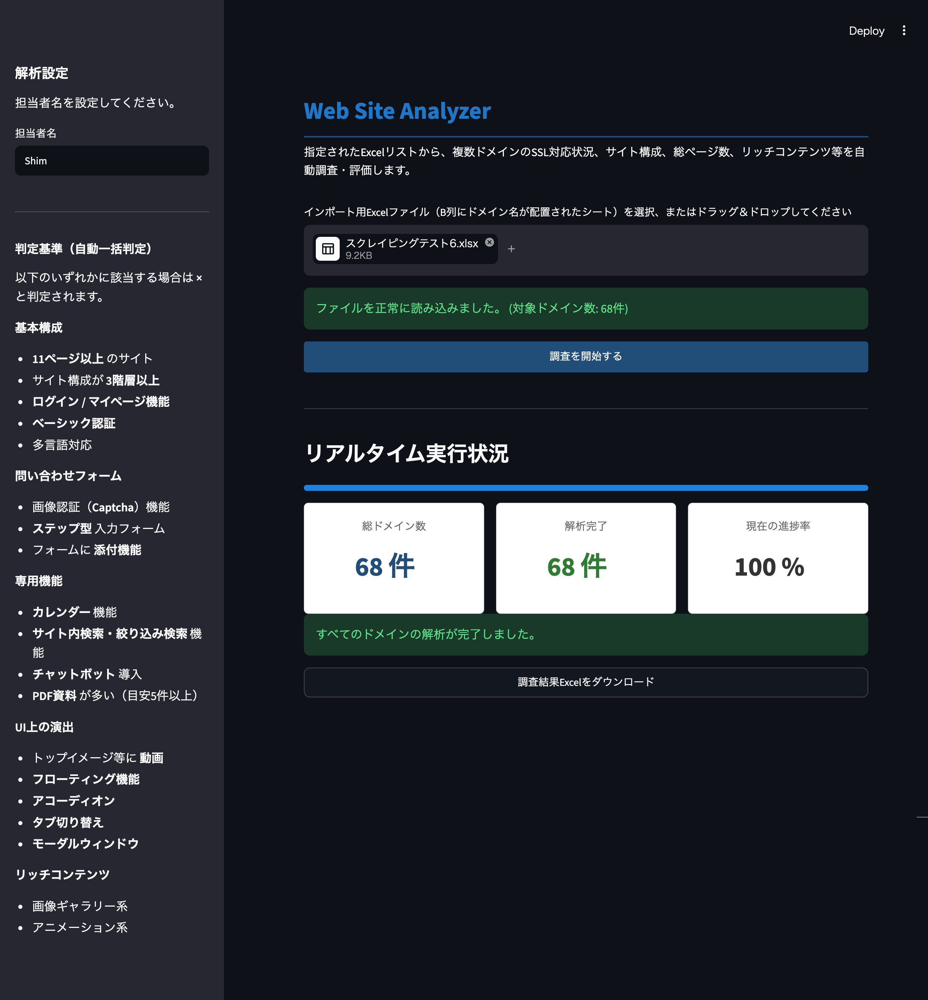

[English](README.en.md) | **日本語**

---

# Web Site Analyzer

Python学習およびポートフォリオ作成を目的として開発した、GUIベースのマルチドメインWebサイト解析・評価システムです。

実務における「並行処理（ThreadPoolExecutorによるマルチスレッド環境でのデータ競合防止）」「SQLiteによるクラッシュ耐性のある状態永続化」「堅牢なクローリングにおける防御機構の突破」「値オブジェクトの設計思想を取り入れた状態管理」など、実践的なバックエンド・アーキテクチャを体系的に学ぶことを目的として開発しました。

---

## 概要

指定されたExcelリスト（B列にドメイン名が配置されたシート）から、複数ドメインの **SSL対応状況（常時SSL判定を含む）、サイト構成（主要CMSの多角的な検出）、総ページ数** を自動的にクローリングし、設定されたページ数しきい値・階層数・ログイン機能・添付機能・ベーシック認証・多言語対応・お問い合わせフォームの画像認証（Captcha）・専用機能（カレンダー／サイト内検索／チャットボット）・デザインギミック（動画／フローティングボタン／アコーディオン／タブ切り替え／モーダル）・リッチコンテンツ（Lightbox／スクロールアニメーション等）の有無に基づき、ビジネス評価（**×, 要確認**）を自動付与するWebアプリケーションです。

単にデータを集めるスクレイパーにとどまらず、「サーバー負荷を最小化するクロールレート制御」「Cloudflareや各種クローラーブロック（403/401エラー）を回避するフェイクヘッダー」「Fortinet等のネットワークセキュリティ機器によるブロックページの検知・原因分類」「移転案内ページ（別ドメインへの自動リダイレクト）の検知」「HTTPリダイレクト追跡とHTTPS個別検証を組み合わせた2段構えのSSL監査機構」「無限リンクトラップを検知して巡回を打ち切る安全機構」を独自実装。

処理状態はSQLiteに永続化され、アプリが強制終了された場合でも次回起動時に自動でジョブ状態を復旧します。

フロントエンドには Streamlit を採用し、`st.rerun()` とバックグラウンドスレッド（内部はThreadPoolExecutorによる並列ワーカー）を協調させたポーリング機構により、進行状況を一切フリーズすることなく滑らかに描画するリアルタイム監視UIを実現しています。

---

## 主な機能

* **並列クローリング（ThreadPoolExecutorによるスレッドプール制御）**
  * ジョブ全体は`threading`によるバックグラウンドスレッドへ完全委譲した上で、ジョブ内の各ドメインは`ThreadPoolExecutor`（デフォルト最大5並列）で同時処理。JSレンダリング（Playwright）を伴う重い処理でも、スループットとメモリ負荷のバランスを取れる並列数に調整。
  * 1ドメインの処理中に例外が発生しても、そのドメインの結果のみ「要確認」として記録し、他のドメインの処理・ジョブ全体の完了は継続する設計。
  * 排他制御（`threading.Lock`）を用いて、複数ワーカースレッドからの解析結果の書き込みをアトミック（一括）に実行。Streamlit側の読込スレッドとのデータ競合や表示の不整合を完全に防止。
  * 重いネットワークI/O処理中も Streamlit の描画メインスレッドを100%解放し、画面フリーズを排除。

* **SQLiteによるクラッシュ耐性のある状態永続化**
  * ジョブ・調査結果はメモリキャッシュだけでなく、WALモードのSQLiteにも同期して保存。1ドメインの解析が完了するたびに即座にDBへ反映するため、途中でプロセスが落ちても完了済みの結果は失われない。
  * アプリ起動時に、前回`processing`のまま異常終了して残っていたジョブを自動検出し`interrupted`状態へ修正する整合性チェック（`reconcile_interrupted_jobs`）を実装。UIが「処理中」のまま固まって見えるゾンビ状態を防止。
  * `st.cache_resource`によりサービス層のインスタンスをプロセス全体で1つに共有し、ブラウザのリロードやセッション切断があってもジョブの進捗状態を保持し続ける。

* **インテリジェントなクローラー防御回避とSSL監査機構**
  * **スマートSSL＆リダイレクト検証**: 初回アクセスは `http://` で行い、WAF（Web Application Firewall）やサーバーによる `https://` への自動リダイレクトの有無を追跡することで、「常時SSL」の判定基準であるリダイレクト処理を正確に検証。リダイレクトされない環境であっても個別に `https://` 接続を検証する柔軟な設計。
  * **HTTPS専用サイトへの対応**: ポート80を受け付けない等、`http://` 接続自体が失敗するHTTPS専用サイトに対しては、`https://` への直接接続を試みるフォールバックを実装し、判定不能への誤フォールバックを回避。証明書のホスト名不一致（SSLError）を検知した場合は`www.`付きドメインでの再試行も行う。
  * **ブラウザと同じ証明書検証**: 証明書の検証は`truststore`経由でOS（Windows/macOS）の証明書ストアに委ねる。requests標準（certifi）の検証では、サーバーが中間証明書を送っていないサイトや、certifiに未収録の新しいルート証明書（例: SECOM TLS RSA Root CA 2024）を使うサイトで、ブラウザでは鍵マーク付きで表示されるのにSSL列が空欄になっていた。期限切れ・ホスト名不一致・自己署名・信頼されていない発行元はこれまでどおりエラーとして扱う。
  * **アクセス拒否ページの検知**: Fortinet Webfilter等のネットワーク機器がSSLインスペクションで通信を遮断・差し替えている場合や、サーバー自身が403 Forbidden／429 Too Many Requests／5xx等のエラーページを返す場合、実サイトの内容ではなくそのページ自体を取得してしまうケースがある。これを検知し、原因（カテゴリ分類、SSL証明書エラーの可能性、サーバー側のボット対策・レート制限等）を判定理由として明示した上で、他の判定ロジックを通さず「要確認」として結果に反映。自動化ツールだけを狙い撃ちでブロックする機器もあるため、httpxでブロックを検知した場合はPlaywright（実ブラウザ）で再確認し、それでもブロックされた場合のみ確定する。
  * **移転案内ページの検知**: meta refreshやJSタイマーによって数秒後に別ドメインへ自動遷移する「移転案内ページ」を検知した場合、通常の判定ロジックを通さず「×（すでにリニューアル済のため）」として即座に確定し、移転先URLを備考欄に記録。あわせて`ReverseDnsChecker`が移転先ドメインのIPアドレスから逆引きホスト名とRDAPの管理組織名を調べ、「サーバー：{逆引きホスト名（管理組織名）}」として備考欄に併記する（取得できなければ「サーバー：取得できませんでした」）。
  * **接続不能時の安全なフォールバック**: DNSエラーやタイムアウト等の例外発生時もシステムをクラッシュさせず判定不能として安全にキャッチ。`https://`（ドメイン名のみの入力時の既定）→`http://`→`www.`付きの順に初回アクセスを試み、すべて失敗した場合は「ページ数 0」として結果を引き継ぎ、最終結果を最優先で『要確認』に分類する堅牢性を担保（ベーシック認証が原因と判明している場合は『×』）。
  * **ブラウザ欺瞞（User-Agent）と通信偽装**: プレーンなPythonスクレイパーを即座にブロックする防御壁を突破するため、最新のWebブラウザ（Chrome）のヘッダー情報を模倣。
  * **無限リンクトラップの検知**: カレンダーページ等が生成する単純な繰り返しパスに加え、JS遷移リンクの誤解決等によって生じる複数セグメント単位の繰り返しパターンも検知し、無限巡回を未然に防止。
  * **ページ数カウント専用の追加巡回**: 本巡回（150秒）が時間切れになり、100ページ未満のまま未訪問リンクが残った場合に限り、CMS判定・フォーム解析等を省いてリンク抽出だけを行う追加巡回（最大120秒・3並列・1リクエスト20秒）でページ数を確定させる。本巡回でタイムアウトしたページもここで取り直すため、応答の遅いサイトでも「36以上」のような下限値で終わりにくく、実行ごとのページ数のぶれも抑えられる。
  * **無駄なリクエストの削減**: 「/about → /about/」の末尾スラッシュ補完リダイレクトを観測したサイトでは、最初から末尾スラッシュ付きでリクエストする（404なら元のURLで取り直す）。サイトの一部だけが逆に末尾スラッシュを外す301を返す場合もあるため、付ける／外す両方向のリダイレクトを数え、付ける方が多い間だけ付ける。また、`href="privacy/"` のような素の相対リンクが別階層の実ページへリダイレクトされるパターン（`privacy.html` → `/privacy-html/` のようにWordPressでスラッグ化される場合を含む）を学習し、同じ誤解決URLを以降の巡回候補から外す。
  * **旧ディレクトリへのリダイレクトの省略**: 「/wp/flow/ → /flow/」のように、パス末尾は同じまま先頭のディレクトリだけが置き換わるリダイレクトを一度観測したら、同じ旧ディレクトリ配下のURLの転送先を推定し、それが既訪問・巡回予定であればリクエスト自体を省く（転送先が未知のURLは従来どおり取得する）。
  * **スラッグ表記揺れの二重カウント防止**: WordPressが`/privacy.html/`と`/privacy-html/`の両方を200で返し、`rel=canonical`で後者を正規URLとして示す場合、canonicalがスラッグの表記揺れだけの違いを示しているときに限りcanonical側のURLでページ数を数える（全ページのcanonicalがトップを指す設定ミスのサイトもあるため、それ以外のcanonicalは使わない）。

* **主要CMSおよびサイト構成の高精度な動的検出**
  * 静的なHTML構文解析だけでなく、`wp-content` / `wp-includes` 資産などのHTMLソース内のシグネチャから、WordPress（出力上は`WP`）、baserCMS、EC-CUBE、Movable Type、Concrete CMS、Shopify、Wixなど約30種の国内外CMSを多角的に判定。非CMSサイトは空欄と自動識別。
  * リンクを辿り尽くしても2ページ以下しか見つからないサイト（JSでページ遷移するサイト等）は、`robots.txt`の`Sitemap:`行や`/sitemap.xml`等に載っているURLで補完して巡回を続ける。
  * 「構成」列のグローバルナビ抽出では、`<nav>`/`<header>`やナビらしいclass・idを持つ要素をスコア付けして候補を選ぶ。メニュー項目はトップレベルの`<li>`単位で数え（ドロップダウン・メガメニューの子リンクで減点されないように）、同点ならメニュー項目の多い方を優先する。ドロップダウン親項目のリンクでない見出し、`<a>`の中に`<li>`を置いた崩れたマークアップ、中身の無いリンクを重ねた項目にも対応し、フッター内・スマートフォン専用（`sp-only`等）の項目、装飾記号・矢印・Material Iconsのアイコン名を除く。ヘッダーで3項目未満しか取れない場合に限り、本文外のサイドバー・ドロワーのメニューも探す。
  * JSレンダリング（Playwright）は常時ではなく必要な場面に限定して使用する：トップページでJSフレームワーク（または中身の空のSPAシェル）を検知した場合の再レンダリング、httpxでアクセス拒否された場合の実ブラウザでの再確認、静的HTMLに入力欄が無いお問い合わせページの再レンダリング（1サイト最大2ページ）。Playwright未導入環境では自動的に通常のHTTP取得へフォールバックする。
  * `<form>` タグに限らず、`role="form"` や擬似フォーム（divベース）も検出対象とし、`aria-labelledby` / `label for` / 祖先要素解析など複数の手がかりからフォーム項目ラベルを解決。HubSpotやTayori等の外部埋め込みフォームも検出。iframe内フォームも再帰的に解析。`<form>`タグの無いJS送信型フォーム（textareaを起点に祖先要素を特定）や、JSフレームワーク製サイトでクライアント側描画されるお問い合わせフォーム（Playwrightで再レンダリング）にも対応し、ナビメニューを項目として誤って拾わないよう除外する。サイト内にフォームが無い場合は、別ドメインのお問い合わせページ（最大3件）も確認し、それでも無ければ`mailto:`リンクの有無に応じて「mailto」／「問い合わせフォームなし」と出力する。

* **判定理由の多角的な自動検知・自動生成**
  * ページ数超過、3階層以上の深いサイト構成、ログイン／マイページ機能、お問い合わせフォームの添付機能、ベーシック認証（401 Unauthorized、初回アクセス時に加えクロール中の各ページ取得時にも検知）、多言語切り替え機能に加え、フォームの画像認証（Captcha）、カレンダー機能、サイト内検索・絞り込み検索、チャットボット導入、動画（videoタグ／YouTube・Vimeo埋め込み）、フローティングボタン、アコーディオン、タブ切り替え、モーダルウィンドウ、Lightbox等のギャラリー機能、GSAP等のスクロールアニメーションの有無まで検出し、判定理由として自動的に列挙。アコーディオン／タブ／モーダル／フローティングボタンの検知は、通常のハンバーガーメニュー等にも使われる汎用属性（`data-toggle`/`aria-expanded`）を避け、機能ごとに独立したCSSセレクタ・クラス名判定で誤検知を抑えている。
  * Google Map埋め込みのみ、ほぼすべてのコーポレートサイトのアクセスページに存在し単独では判定基準として機能しにくいため、意図的に対象外としている。
  * 階層数が極端に深く自動計測が信頼できない場合（10階層超）は、無理に数値化・判定せず「要確認」として人手での確認に委ねる設計。

* **用途・構成のAI補完とページ数の再計測（別画面）**
  * サイドバーの「機能」で「用途・構成のAI補完」を選ぶと、完成した調査結果Excelをアップロードし、次の3種類の補完をチェックボックスで選んで実行できる。アップロード時点で列ごとの対象件数を表示し、実行中は対象数・完了数・進捗率をサイト調査と同じカードで表示する。
    * **用途（K列）**: 空欄・40文字未満・社名やキーワードを区切り記号で並べただけの行を、サイトを取り直してGemini APIで100文字前後のサイト概要に要約する。トップページに加え、会社概要・事業内容らしいページ（最大2ページ）も材料にする。
    * **構成（H列）**: 空欄・3項目未満、または電話番号・メールアドレス・外部リンク（↗）・コピーライト表記が混ざった行を補完する。調査本体と同じルールで取れたメニューと、ページ内のメニューのリスト（`WebCrawler.collect_nav_candidates()`、最大12件）を候補にし、Geminiにはグローバルナビにあたる候補を**番号で選ばせるだけ**にして、項目名はサイト上の文字をそのまま使う（言い換えや存在しない項目の混入を防ぐ）。静的HTMLに候補が1つも無い場合（ヘッダーをJSで差し込むサイト等）はPlaywrightで描画したトップページで判定し直す。
    * **ページ数（I列）の再計測**: 時間切れで「〇〇以上」（100未満）になった行を、時間予算を延ばして巡回し直す（本巡回300秒＋カウント専用の追加巡回300秒、1リクエスト15秒。Geminiは使わない）。時間切れで「要確認」になっていた行は調査結果（C・M・N列）も判定し直し、既に「×」の行はページ数がしきい値を超えたことが新たに分かった場合だけ「ページ数が多いため」を追記する。
  * 「全行をやり直す」をオンにすると、チェックした用途・構成を全行補完し直す（ページ数は確定済みの行を再計測しない）。M列が「すでにリニューアル済のため」の行は常に対象外。
  * 調査本体とは切り離して実行するため、調査の速度やGeminiの無料枠のレート上限の影響を受けない。全スレッド共通でリクエスト間隔（既定6秒）を空け、429が続いた場合は10分間Geminiの呼び出しを停止する。利用上限のためAIで判定できなかったサイトは画面で別途一覧表示する（構成はルールで取れたメニューがあればそれを入れる）。
  * 補完できたセルは淡い黄色、できなかったセル（ページ数が確定しなかったセルを含む）は淡いピンクで塗り分け、出力ファイル（`{元のファイル名}_AI補完.xlsx`）に再度かければ残りの行だけが対象になる。元のExcelの書式はそのまま残し、書き換えたセルの値と行の高さだけを更新する。

* **セッションステートを用いた堅牢なリアルタイムUI**
  * Streamlitのステートフル（`st.session_state`）な設計。URLクエリパラメータにも`job_id`を保持することで、ブラウザが完全にリロードされ新しいセッションになった場合でも進行中のジョブを追跡し続けられる。
  * `while True` によるブロッキングループを排除し、`st.rerun()` とバックグラウンドスレッドによる「能動的非同期ポーリング」（約1.5秒間隔）を採用することで、進捗表示とメトリクスカードをリアルタイム更新。

* **Mypy Strict適合を意識したモデル設計と型安全性の徹底**
  * ドメインモデル `ScrapingJob` のプロパティをイミュータブル（Read-only）に設計し、スレッドセーフな状態管理を強制。状態の書き換えが必要な場合は、新しいインスタンスを再生成する「値オブジェクト」の設計思想を徹底。
  * `SiteAssessment` モデル内の数値を扱うフィールド（ページ数、階層数）の型定義は `int | None` を基本とし、判定ロジック（`RenewalEvaluator`）には `parse_lower_bound()` で数値化した `int` のみを渡すことで、ビジネスロジック内の型安全性を確保。なお、クローラーが返す下限値表記（100ページ上限到達時の `"100以上"`、時間切れ時の `"36以上"` 等）や階層数の `"要確認"` は、現状 `SiteScraperService` が文字列のまま格納している（該当箇所は `# type: ignore` で型チェックを回避）。未取得・0の値はExcel出力時に空欄へ変換する。

* **共通ロギング基盤とデコレータによる横断的関心事の分離**
  * `dictConfig` ベースの共通ロガー設定（`utils/logger.py`）をアプリ起動時に一度だけ適用し、コンソール（INFO以上）とログファイル（実行ごとに秒単位まで含めた個別ファイル `logs/app_YYYYMMDD_HHMMSS.log`、DEBUG以上）の両方へ出力。各モジュールは`logging.getLogger(__name__)`のみで統一されたログ設定の恩恵を受けられる設計。
  * `measure_time`（処理時間計測）・`log_action`（開始/完了ログ）といった横断的関心事をデコレータとして切り出し、クロール処理・SSLチェック・Excel出力の各所に薄く適用。ビジネスロジック本体にログ出力コードを混在させない設計を採用。

---

## Screenshots

### Main Window



---

## 使用技術

| 分類 | 技術 |
| --- | --- |
| Language | Python 3.12+ |
| Package Management | uv |
| Web UI Framework | Streamlit (Custom Flat UI with CSS styling) |
| Scraping & Parsing | HTTPX, BeautifulSoup4（`lxml`パーサー優先、Playwrightによるオプショナルなレンダリング対応） |
| SSL Verification | Requests + truststore（OSの証明書ストアで検証） |
| Server Lookup | socket（正引き・PTR逆引き）, RDAP（`rdap.org`、HTTPX経由） |
| AI Summarization | Gemini API（`generateContent`、HTTPX経由。既定モデル `gemini-3.5-flash-lite`） |
| Persistence | SQLite（WALモード） |
| Data Processing | OpenPyXL (Excel import / export, 列幅・行高の自動調整) |
| Testing | Pytest |
| Linter & Formatter | Ruff |
| Type Check | Mypy (Strict仕様適合) |
| CI/CD | GitHub Actions |

---

## ディレクトリ構成

```text
PYTHON-WEB-ANALYZER/
├── .devcontainer/             # Dev Container / Codespaces 設定
├── .github/workflows/ci.yml   # GitHub Actions CI定義
├── .streamlit/config.toml     # Streamlitサーバー設定（ポート8502等）
├── .streamlit/secrets.toml    # （任意・Git管理外）GEMINI_API_KEY の設定
├── .streamlit/secrets.toml.example # secrets.toml の雛形
├── docs/                      # ドキュメント関連ファイル
│   ├── images/                # スクリーンショット・アイコン
│   ├── model_design.md        # クラス設計・モデル設計
│   ├── requirements_definition.md # 要件定義書
│   └── screen_transition.md   # 画面遷移・処理フロー図
├── src/
│   └── web_analyzer/          # アプリケーションソースコード
│       ├── core/              # コアロジック
│       │   ├── crawler.py         # クローラー（Web探索・取得・ブロック検知・移転検知）
│       │   ├── description_enricher.py # 調査結果Excelの用途・構成のAI補完とページ数の再計測
│       │   ├── evaluator.py       # 評価・判定ロジック
│       │   ├── excel_service.py   # Excel出力・フォーマット調整
│       │   ├── job_repository.py  # SQLiteへのジョブ・調査結果の永続化
│       │   ├── scraper_service.py # 並列スクレイピングオーケストレーション（ThreadPoolExecutor）
│       │   ├── site_summarizer.py # Gemini APIによるサイト概要の要約・グローバルナビの選択
│       │   ├── ssl_checker.py     # SSL/TLS証明書・リダイレクト検証
│       │   └── reverse_dns_checker.py # 逆引き・RDAPによるサーバー情報の取得（移転先URL用）
│       ├── utils/             # 共通ユーティリティ関数
│       │   ├── decorators.py      # measure_time / log_action デコレータ
│       │   └── logger.py          # dictConfigベースの共通ロガー設定
│       ├── __init__.py
│       ├── cli.py             # `web-analyzer` コマンドの起動用ラッパー
│       ├── main.py            # アプリケーションのエントリーポイント（Streamlit UI）
│       └── models.py          # データモデル定義（ScrapingJob / SiteAssessment）
├── data/                       # SQLiteデータベースファイル出力先
├── temp/                      # 一時ファイル出力用ディレクトリ
├── logs/                      # 実行ごとのログファイル出力先
├── tests/                     # ユニットテスト
│   ├── test_crawler_global_nav.py # グローバルナビ抽出のテスト
│   ├── test_description_enricher.py # AI補完・ページ数再計測のテスト
│   ├── test_evaluator.py      # 評価ロジックのテスト
│   ├── test_excel_service.py  # Excel入出力のテスト
│   ├── test_reverse_dns_checker.py # サーバー情報取得のテスト
│   ├── test_site_summarizer.py # Gemini呼び出し（要約・ナビ選択・レート制限）のテスト
│   └── test_ssl_checker.py    # SSL検証のテスト
├── .gitignore
├── .python-version
├── LICENSE                    # MITライセンス
├── pyproject.toml             # プロジェクト設定・依存関係定義
├── README.md                  # プロジェクト概要・評価者向け説明書
├── README.en.md               # 英語版README
└── uv.lock                    # uvロックファイル（厳密なバージョンロック）

```

---

## 前提環境

* Python 3.12以上
* uv (一貫した開発・実行環境を再現するため必須)

`uv` がインストールされていない場合は以下を実行してください。

```bash
pip install uv

```

---

## インストールと環境再現 (uvによる依存関係ロック)

`uv` を用いて、配布環境や開発環境でのバージョンズレによるバグを100%防止し、一貫した実行環境を再現します。

```bash
git clone <repository-url>
cd PYTHON-WEB-ANALYZER

# uv を用いて lock ファイルに記録された依存関係を完全に同期 (自動で仮想環境が作成されます)
uv sync

# （任意）JSレンダリングを有効にする場合は、Playwright用のChromiumを導入
# 未導入でも動作するが、JS描画サイトの検知精度が下がる
uv run playwright install chromium

```

---

## 起動方法

```bash
uv run streamlit run src/web_analyzer/main.py

# または（上と同じ。追加の引数はstreamlitへそのまま渡される）
uv run web-analyzer

```

`.streamlit/config.toml` によりポート `8502` で起動します（ブラウザで `http://localhost:8502` を開く）。Dev Container / GitHub Codespaces で開いた場合は、`uv sync` とアプリ起動が自動で実行されます。

### Gemini APIキーの設定（用途・構成のAI補完を使う場合のみ）

`.streamlit/secrets.toml` に記載するか、環境変数 `GEMINI_API_KEY` を設定します（`secrets.toml` → 環境変数の順に参照）。Windowsの `setx` で設定した環境変数は、設定前から開いていたターミナル（VS Codeの内蔵ターミナルはVS Code自体の再起動まで）から起動したアプリには反映されないため、`secrets.toml` での設定を推奨します。

雛形の `.streamlit/secrets.toml.example` をコピーして作成できます。

```bash
cp .streamlit/secrets.toml.example .streamlit/secrets.toml
```

```toml
# .streamlit/secrets.toml
GEMINI_API_KEY = "your-api-key"
```

任意で、環境変数 `GEMINI_MODEL`（使用モデル）、`GEMINI_MIN_INTERVAL_SEC`（リクエスト間隔の秒数。既定6秒＝最大10RPM）で調整できます。

実行時には、カレントディレクトリ（プロジェクトルート）配下に `data/jobs.db`（SQLite）、`temp/`（アップロード・出力Excel）、`logs/`（ログファイル）が自動作成されます。

---

## 品質管理・テスト

### テスト実行

```bash
uv run pytest

```

### Ruff (Linter & Formatter)

```bash
uv run ruff check .
uv run ruff format .

```

### Mypy (Type Check)

```bash
uv run mypy src tests

```

---

## GitHub Actions (CI)

GitHub Actionsを利用したCIパイプライン（`.github/workflows/ci.yml`）を構築しています。

push / pull request のたびに、単一ジョブ `lint-and-test` 内で以下のステップを順に実行します。前のステップが失敗した時点でジョブは終了するため、静的解析に失敗した場合はテストまで進みません。

1. Ruff（Lint）: `uv run ruff check .`
2. Ruff（Format Check）: `uv run ruff format --check .`
3. Mypy（Type Check）: `uv run mypy src`
4. Pytest: `uv run pytest`

---

### ユニットテストの検証範囲

堅牢性を担保するため、`pytest` を用いたコアロジックの単体テストを徹底しています。

#### 1. 評価・判定ロジック (Evaluator)

* **しきい値評価の妥当性テスト**：指定されたページ数しきい値（`page_threshold`）、階層数、ログイン機能有無、添付機能有無、ベーシック認証有無、多言語対応有無、お問い合わせフォームの画像認証（Captcha）、専用機能（カレンダー／サイト内検索／チャットボット）、デザインギミック（動画／フローティングボタン／アコーディオン／タブ切り替え／モーダル）、リッチコンテンツ有無の各条件に基づいて、`◯` / `×` の判定と理由テキストが正確にマッピングされるかのテスト。
* **保留判定（要確認）の自動生成検証**：接続失敗時（ページ数0）、階層数が計測不能なほど深い場合、および内部リンクを巡回し尽くさずにクロールが打ち切られた場合に、`RenewalEvaluator.decide()` が『要確認』を返す挙動と、`×`の根拠が1つでも確定していればそちらを優先する挙動、`×`の根拠が無い場合に『◯』ではなく『要確認』を返す挙動の検証。これらの分岐は`evaluator.py`側に集約されており、`SiteScraperService`側にはこの判断ロジックを持たせていない。

#### 2. Excel入出力サービス (ExcelService)

* **入出力の妥当性**：インポート時にB列（空ならA列）からドメインを読み取り、`サイト名`等のヘッダー行をスキップできるかの検証。エクスポート時に、A〜O列の固定ヘッダーの下へ各フィールドが正しいセルに出力されるか、`"100以上"`等の下限値表記がそのまま出力されるか、ページ数・階層数が0の場合に空欄になるかの検証。制御文字混入時に例外を出さず除去できるかの検証も含む。

#### 3. セキュリティ監査モジュール (SslChecker)

* **SSL接続・リダイレクト検証の正常性**：初期接続パラメーター（最大10秒のリクエストタイムアウト設定）の妥当性、`http://` 接続自体が失敗した場合の `https://` 直接接続フォールバック、証明書ホスト名不一致時のみ`www.`付きドメインで再試行する分岐、および正常なHTTPS通信から例外発生時（判定不能時の `None, None` 返却）にいたるまでのハンドリング検証。HTTPS接続の証明書検証がOSの証明書ストア（`truststore`）を使うアダプタで行われることも検証。`requests.Session`をモック化した`FakeSession`によって外部通信を伴わずロジックのみを検証。

#### 4. グローバルナビ抽出 (WebCrawler)

* **「構成」列の抽出精度**：`<nav>`内で最も大きいリストを選びスマートフォン専用項目を除くこと、サイト共通のサイドバーへのフォールバックとブログのカテゴリ一覧を拾わないこと、ドロップダウン親項目の見出し、メガメニューの子リンクで減点されないこと、URLエンコードされたフッターメニューidの除外、崩れたマークアップ（`<a>`内の`<li>`、中身の無いリンクを重ねた項目）、アイコン名・矢印の除去、`collect_nav_candidates()`がリスト外のリンク群も候補にすることを、HTML断片で検証。

#### 5. AI補完 (DescriptionEnricher / SiteSummarizer)

* **補完対象の判定と書き込み**：用途・構成・ページ数それぞれの対象判定、「すでにリニューアル済」行の除外、用途と構成が両方対象の行でサイト取得が1回で済むこと、構成の候補からAIの選んだものを使うこと（AI呼び出し失敗時はルールの結果、電話番号・SNS項目の除去、静的HTMLに候補が無い場合のみ描画し直すこと）、ページ数再計測に伴う調査結果（C/M/N列）の書き換え、利用上限で判定できなかった行の報告を、`SiteSummarizer`等をスタブ化して外部通信なしで検証。
* **Gemini呼び出し**：要約の材料の組み立て、APIキー未設定・APIエラー時に空文字を返すこと、429が続いた場合のクールダウンと`pop_rate_limited()`による報告（429以外のエラーは上限扱いしないこと）を、`httpx.post`をモック化して検証。

#### 6. サーバー情報取得 (ReverseDnsChecker)

* **逆引き・RDAPの組み立て検証**：RDAPレスポンスから管理組織名を優先順位（`registrant`の`fn` → `remarks`先頭 → ネットワーク名）どおりに抽出できるか、通信失敗・不正なレスポンス時に空文字を返すか、URLからホスト名のみを取り出して正引きするか、ホスト名・組織名の片方しか取れない場合の出力形式、正引きできない場合に後続の問い合わせを行わないことを、`socket`/`httpx`をモック化して検証。

---

## 本プロジェクトで学んだ高度な技術テーマ

### 1. ThreadPoolExecutorによる並列処理とSQLiteによるクラッシュ耐性設計

Streamlitは「イベントや状態変化のたびに全コードが先頭から再実行される」という特殊なライフサイクルを持っています。そのため、重い処理をバックグラウンドに逃がすだけでなく、`ThreadPoolExecutor`で複数ドメインを同時処理する場合、メインスレッドがポーリングでデータを読み出す瞬間にワーカースレッド側がデータを中途半端に書き換えてしまうとUIの崩れや誤判定（競合状態）が発生します。
本システムでは、`threading.Lock` を導入してデータモデルの全プロパティの書き換えを一括（アトミック）で実行するスレッドセーフな同期デザインに加え、1件完了するたびにSQLite（WALモード）へ即座に反映することで、プロセスが不意に落ちても完了済みの結果を失わない永続化設計を習得しました。起動時に「processingのまま残ったジョブ」を検出し復旧する仕組みも合わせて実装しています。

### 2. クローラー拒否の回避と多層的なフォールバック網

商用Webサイトの解析では、セキュリティフィルター（WAF・ネットワークセキュリティ機器等）による拒否や、サーバー独自のプロトコル制限に直面します。
本システムの開発を通じ、適切なUser-Agent偽装、接続リクエストごとのタイムアウト制限、`http://` からのリダイレクト追跡と個別HTTPS検証、HTTPS専用サイトへの直接フォールバック、さらにはFortinet等のネットワーク機器が返すブロックページ自体を検知して原因を分類する仕組みを組み合わせることで、エラーでスタックすることなく安全に結果を持ち帰る「フォールバック前提のクライアント設計」を習得しました。

### 3. ドメインモデル設計の分離と完全な静的型付け

状態変更が多発する並行処理システムにおいて、データ型の曖昧さはバグの最大の原因になります。
本システムでは、ジョブの状態変化時に新しいインスタンスを再生成するイミュータブル（不変）アプローチと、データの保持には純粋な数値型を用いつつ表示用変換を出力層まで遅延させるアプローチを採用しました。これにより、Mypyの厳格な型チェックをパスし、リファクタリング耐性の極めて高い堅牢なプログラム構造を実現するスキルを習得しました。

---

## License

MIT License
