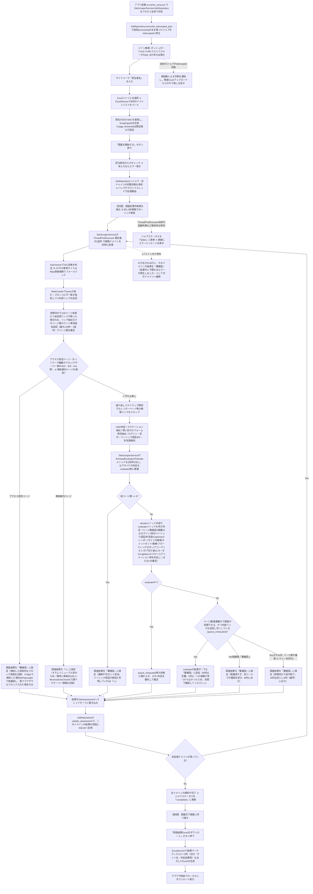
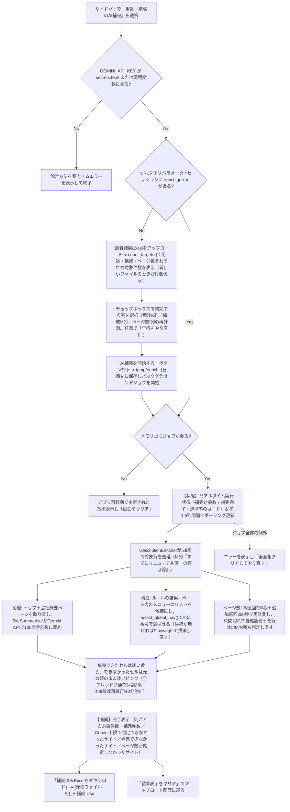

# 画面遷移・処理フロー図

メイン画面を中心に、起動時のジョブ復旧、Excelインポートから並列スクレイピング、判定、および結果ダウンロードの処理フローです。

## 用途・構成のAI補完画面

サイドバーの「機能」ラジオで「用途・構成のAI補完」を選ぶと、調査画面の代わりに表示される独立した画面です（実行中の調査ジョブはバックグラウンドで継続します）。画面の構成（アップロード → 件数の確認 → 開始 → リアルタイム実行状況 → ダウンロード）はサイト調査の画面にそろえています。

## 補足・旧仕様からの変更点

* サイドバー先頭に「機能」ラジオ（「サイト調査」／「用途・構成のAI補完」）が追加された。AI補完はGemini APIを使う独立した後処理（ページ数の再計測はGeminiを使わない）で、調査本体の判定・処理時間には影響しない。旧名は「用途(K列)の補完」で、K列のみが対象だった。
* サイドバーに「カスタム閾値」を入力させるUI要素は**削除**されている。判定に使われる `page_threshold` は `ScrapingJob` の既定値（`10`）で固定運用される。
* 旧仕様にあった「閾値1〜3による◎/◯/△/×の4段階判定」は廃止され、現在は **×と要確認の2値** の運用になっている（自動判定で「◯」は出さず、×の根拠が無いものは要確認として人手で確認する）。
* **バックグラウンド処理は「ドメイン単位の逐次処理」ではなく、`ThreadPoolExecutor`によるドメイン単位の並列処理（既定最大5並列）に変更されている。** 1ドメインの処理失敗（例外）はログに記録された上でそのドメインだけ「要確認」として次へ進む。ジョブ全体が失敗扱いになるのは、`ThreadPoolExecutor`の起動自体が失敗するなど個別ドメインの範囲外で予期しない例外が発生した場合のみ。
* **ジョブ・調査結果の状態がSQLite（WALモード）へ永続化されるようになった。** ジョブ開始時に全ドメインの初期状態を保存し、1ドメインの解析が完了するたびに即座にその行だけをDBへ反映する。これにより、処理途中でアプリが強制終了しても、完了済みの結果はディスクに残る。
* **アプリ起動時に`reconcile_interrupted_jobs()`を実行し、前回`processing`のまま異常終了して残っていたジョブを自動検出して`interrupted`状態に修正する処理が新設された。** 画面には「前回の処理は中断されました。再度Excelをアップロードしてやり直してください」という趣旨のメッセージが表示される。
* **クロール開始直後〜巡回中に、アクセス拒否ページ（ネットワークセキュリティ機器（Fortinet等）によるブロックページ、またはサーバー自身の403/429/5xx等のエラーページ）、または別ドメインへ自動遷移する移転案内ページを検知する分岐が新設された。** これらを検知した場合は`RenewalEvaluator.decide()`を呼ばずに結果を確定する（前者は「要確認」＋検知したブロック原因、後者は「×（すでにリニューアル済）」＋備考欄への移転先URLとサーバー情報の記録）。
* 「要確認」に倒れる条件は、総ページ数0／階層数計測不能／`×`の根拠が無いままクロールが時間切れで途中終了、の3パターン。ただし`×`の根拠が1つでも確定していれば、クロールが途中終了していてもそちらを優先する。
* `×`判定の理由に多言語対応（言語切り替え機能）が追加されている。クローラー側での検知に加え、evaluator側でもHTML内の言語切り替えUIを二重にチェックする。**「ステップ型フォーム」「PDF資料が多い」という判定理由は実装されていない。**
* アコーディオン／タブ／モーダル／フローティングボタンの検知は機能ごとに独立したCSSセレクタで判定しており、汎用属性（`data-toggle`/`aria-expanded`）は誤検知の原因になり得るため使用していない。
* `WebCrawler.crawl_and_analyze`の戻り値は**15要素**のtupleに拡張されている（`has_multilang`、`blocked_reason`、`redirect_target_url`、`queue_exhausted`、`subsystem_note`を含む）。ただし`subsystem_note`（別システム同居の注記）は誤検知が避けられなかったため現在は無効化されており、常に空文字列となる。
* `models.py`は`web_analyzer/core/models.py`ではなく`web_analyzer/models.py`に配置されている。
* ロギング基盤が整備され、`main.py`起動時に`setup_logger()`を1回呼び出すことで、コンソールに加えて実行ごとに個別のログファイル（`logs/app_YYYYMMDD_HHMMSS.log`）にもログが出力されるようになった。あわせて`measure_time`（処理時間計測）・`log_action`（開始/完了ログ）デコレータが、クロール・SSLチェック・Excel出力の各処理に適用されている。
* 「要確認」に倒すかどうかの判断（総ページ数0／階層計測不能／時間切れで途中終了）は`RenewalEvaluator.decide()`に集約されており、`SiteScraperService`はSSLチェック→クロール→（ブロック/移転チェック）→`decide()`呼び出し→結果書き込み→DB即時反映、というオーケストレーションに専念する。
